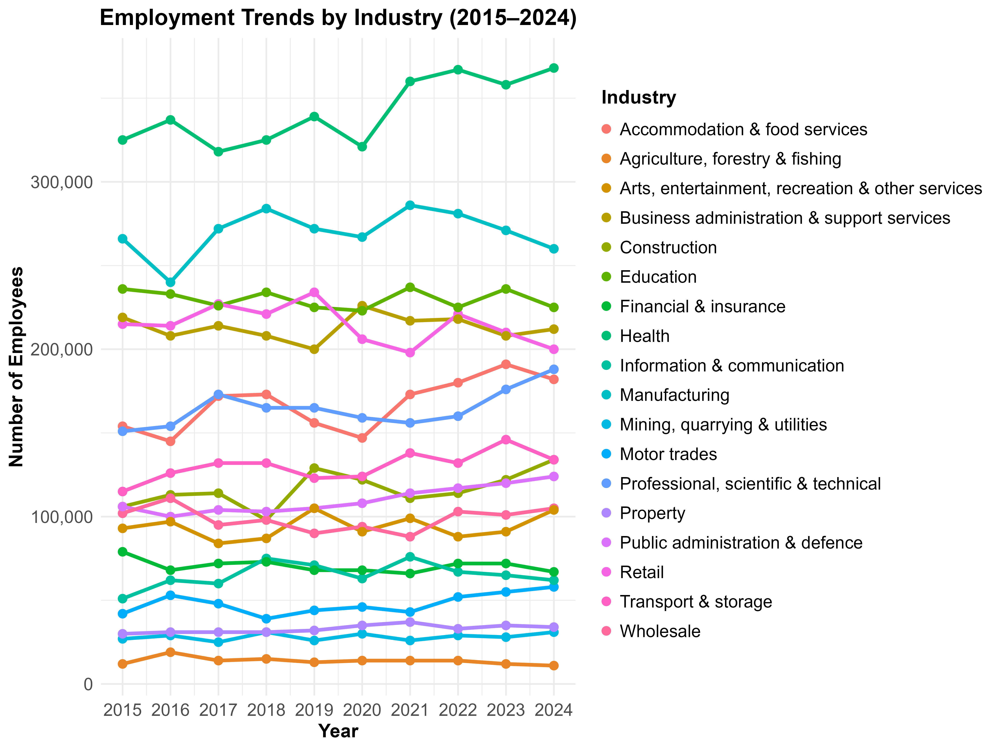
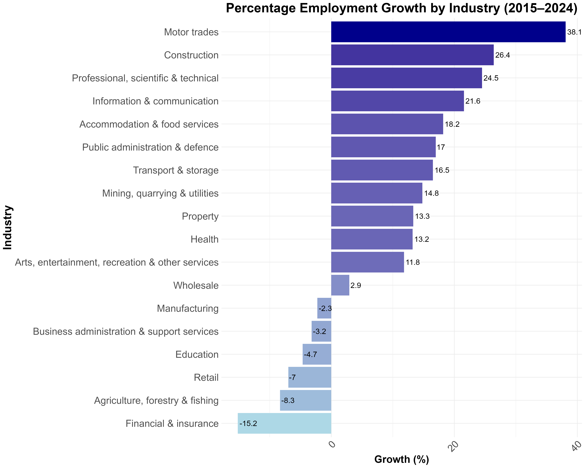
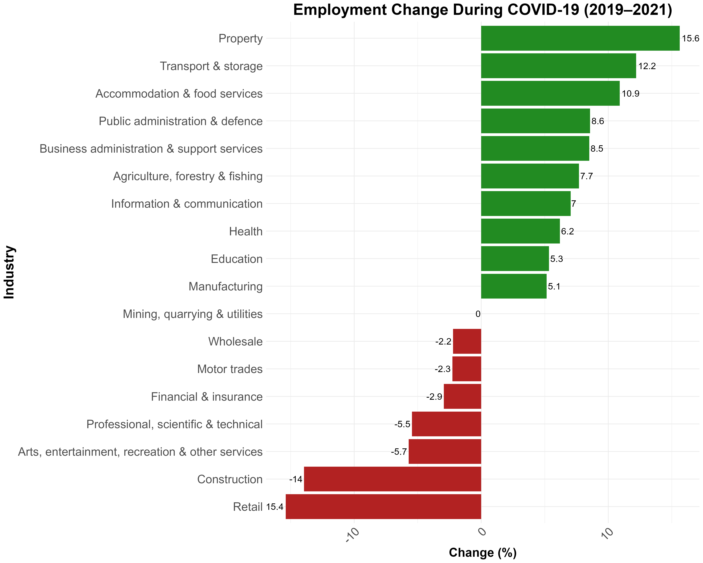
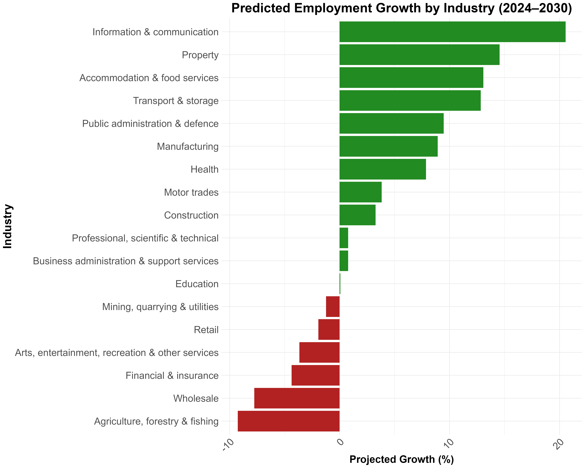
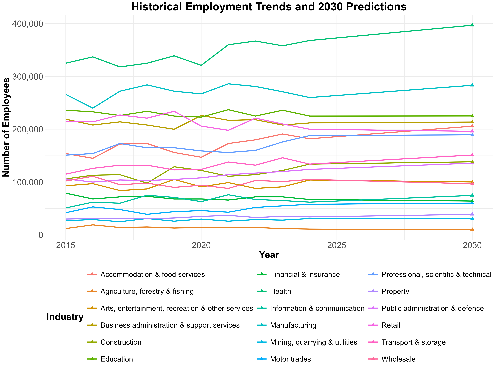

# Yorkshire Employment Analytics: Trends, Forecasting and Visualisation

## Project Overview

This project investigates employment trends across industries in Yorkshire and the Humber between 2015 and 2024, examining long-term structural changes, the impact of the COVID-19 pandemic and potential employment developments through to 2030.

Using data from the Business Register and Employment Survey (BRES), the project combines statistical analysis, regression-based forecasting and data visualisation to explore regional employment patterns.

The project brings together two related MSc Data Science assignments completed at the University of Sheffield:

1. **Employment Analysis and Forecasting:** Investigates historical employment trends, industry-level changes during the COVID-19 period and employment projections to 2030 using linear regression.
2. **Employment Trends and Visualisation:** Examines post-pandemic employment changes through comparative visualisations, focusing on sectoral performance and recovery.

Together, these analyses demonstrate data preprocessing, exploratory data analysis, statistical modelling, forecasting, data visualisation and analytical communication using R.

## Project Structure

```text
yorkshire-employment-analytics/
│
├── 01_data/
│   └── bres_yorkshire_industry.xlsx
│
├── 02_scripts/
│   ├── 01_employment_analysis.R
│   └── 02_employment_visualisation.R
│
├── 03_visualisations/
│   ├── 2030_predictions_line_graph.png
│   ├── composite_visualisation.png
│   ├── covid_employment_change.png
│   ├── employment_trends_all_industries.png
│   ├── employment_trends_top5_industries.png
│   ├── heatmap_chart.png
│   ├── line_chart.png
│   ├── percentage_growth_by_industry.png
│   ├── predicted_2030_employment_piechart.png
│   ├── predicted_employment_change.png
│   ├── scatter_chart.png
│   └── small_multiples.png
│
├── 04_reports/
│   ├── 01_employment_analysis_and_forecasting.pdf
│   └── 02_employment_trends_and_visualisation.pdf
│
└── README.md
```

### Directory Overview

| Directory / File | Description |
|------------------|-------------|
| `01_data/` | BRES industry employment dataset covering Yorkshire and the Humber. |
| `02_scripts/` | R scripts for data preprocessing, statistical analysis, forecasting and visualisation. |
| `03_visualisations/` | All 12 figures generated across both analyses. |
| `04_reports/` | Detailed reports documenting the methodology, results and findings. |
| `README.md` | Project overview, analytical methods, results and usage instructions. |

## Dataset

- **Source:** Business Register and Employment Survey (BRES)
- **Region:** Yorkshire and the Humber, United Kingdom
- **Period:** 2015–2024
- **Format:** Excel (`.xlsx`)
- **Location:** `01_data/bres_yorkshire_industry.xlsx`

The dataset contains annual employment estimates across 18 industry categories.

The main variables are:

- `Industry`: Industry classification or economic sector.
- `Year`: Annual observations between 2015 and 2024.
- `Employees`: Estimated number of employees in each sector.

Data preprocessing involved removing unnecessary columns, cleaning industry names and restructuring the dataset from wide to long format.

## 1. Employment Analysis and Forecasting

### Objectives

The analysis investigates three research questions:

1. Which industries experienced the strongest employment growth between 2015 and 2024?
2. How did employment levels change across industries during the COVID-19 period (2019–2021)?
3. Which industries are projected to grow or decline by 2030?

### Methodology

**Data Preprocessing**
- Import the BRES dataset using R.
- Remove unnecessary data flags.
- Standardise industry names.
- Reshape employment observations into long format.
- Check for missing and invalid observations.

**Exploratory Data Analysis**
- Examine historical employment trends across industries.
- Identify major employment sectors.
- Calculate percentage employment changes.
- Compare employment levels before and during the pandemic.

**Forecasting**
- Fit industry-specific linear regression models.
- Use year as the predictor and employment count as the response variable.
- Generate employment projections to 2030.
- Calculate projected percentage changes relative to 2024.

### Historical Employment Trends (2015–2024)

The following chart illustrates employment changes across industries over the ten-year period.



Health and Manufacturing remained among the largest employment sectors, while several service and knowledge-intensive industries demonstrated substantial growth.

### Industry Employment Growth



| Industry | Employment Change (2015–2024) |
|----------|------------------------------:|
| Motor Trades | +38.1% |
| Construction | +26.4% |
| Professional, Scientific & Technical | +24.5% |
| Information & Communication | +21.6% |
| Accommodation & Food Services | +18.2% |
| Health | +13.2% |
| Financial & Insurance | -15.2% |

Motor Trades recorded the strongest proportional employment growth, followed by Construction and Professional, Scientific & Technical services.

### COVID-19 Employment Changes (2019–2021)



| Industry | Employment Change |
|----------|------------------:|
| Property | +15.6% |
| Transport & Storage | +12.2% |
| Accommodation & Food Services | +10.9% |
| Retail | -15.4% |
| Construction | -14.0% |

The pandemic period saw uneven employment changes across industries, with Retail and Construction experiencing substantial declines while Property and Transport & Storage recorded increases.

These figures describe observed employment changes rather than establishing the direct causal effect of COVID-19.

### Employment Forecasts to 2030

Industry-specific linear regression models were used to estimate future employment based on historical trends.



| Industry | Projected Growth (2024–2030) |
|----------|-----------------------------:|
| Information & Communication | +20.6% |
| Property | +14.5% |
| Accommodation & Food Services | +13.1% |
| Transport & Storage | +12.8% |
| Manufacturing | +8.9% |
| Health | +7.9% |
| Retail | -1.9% |
| Financial & Insurance | -4.4% |
| Wholesale | -7.8% |
| Agriculture, Forestry & Fishing | -9.3% |

Information & Communication is projected to experience the strongest proportional growth, while Agriculture, Forestry & Fishing and Wholesale show the largest projected declines.

The forecasts assume that historical linear trends provide a reasonable basis for future employment estimates. They do not account for unexpected economic shocks or policy changes.

### Historical and Forecast Employment Trends



This visualisation combines observed employment trends from 2015 to 2024 with estimated employment levels for 2030.

**Full Report:** [Employment Analysis and Forecasting](04_reports/01_employment_analysis_and_forecasting.pdf)

## 2. Employment Trends and Visualisation

### Objectives

The visualisation analysis investigates the following research question:

**What structural changes occurred in industry employment in Yorkshire and the Humber following the COVID-19 pandemic, and how did these changes vary across sectors?**

This analysis focuses on communicating employment patterns, industry-level differences and post-pandemic recovery using complementary visualisation techniques.

### Methodology

The analysis uses the same BRES dataset, covering employment between 2015 and 2024.

Data preparation involved:

- Cleaning and standardising industry names.
- Removing unnecessary data flags.
- Reshaping the dataset into long format.
- Calculating industry-level employment changes.
- Comparing pre-pandemic employment levels with post-pandemic recovery.

Visualisations were developed using R and `ggplot2`, informed by the Grammar of Graphics and ASSERT visualisation framework.

### Composite Employment Visualisation

The central output is a composite visualisation combining four complementary charts.


The composite includes:

**1. Employment Trends by Industry (Line Chart)**

Displays annual employment levels between 2015 and 2024, highlighting long-term growth, decline and pandemic-related disruption.

**2. Relative Employment Change (Heatmap)**

Compares percentage employment changes between 2019 and 2021 using a diverging colour scale.

**3. Five Most Affected Industries (Small Multiples)**

Presents separate time-series charts to compare industry-specific employment patterns and recovery trajectories.

**4. Pre-Pandemic Employment Size vs Recovery Rate (Scatterplot)**

Compares industry employment in 2019 with recovery rates in 2024 to explore differences in sectoral resilience.

### Additional Visualisations

The following individual charts are also available:

| Visualisation | Description |
|---------------|-------------|
| [Industry Line Chart](03_visualisations/line_chart.png) | Employment trends across sectors from 2015 to 2024. |
| [Employment Change Heatmap](03_visualisations/heatmap_chart.png) | Relative employment changes between 2019 and 2021. |
| [Industry Small Multiples](03_visualisations/small_multiples.png) | Employment trajectories for five selected industries. |
| [Recovery Rate Scatterplot](03_visualisations/scatter_chart.png) | Pre-pandemic employment size compared with post-pandemic recovery. |

### Key Findings

- Employment trends differed considerably across industries between 2015 and 2024.
- Retail and Construction experienced substantial employment reductions between 2019 and 2021.
- Health demonstrated relatively strong employment performance over the wider study period.
- Recovery patterns varied across sectors, with some industries exceeding pre-pandemic employment levels by 2024.
- Combining multiple chart types provided a clearer understanding of sectoral growth, employment disruption and recovery.

### Visualisation Design Principles

The visualisation analysis incorporated:

- **Clarity:** Selecting chart types appropriate for each analytical question.
- **Accessibility:** Using readable labels, appropriate scales and distinguishable colour encodings.
- **Comparability:** Supporting comparisons across industries and years.
- **Interpretability:** Combining visual representations to communicate broader employment patterns.
- **Ethical Communication:** Recognising limitations and avoiding misleading interpretations of employment changes.

**Full Report:** [Employment Trends and Visualisation](04_reports/02_employment_trends_and_visualisation.pdf)

## Tools and Technologies

| Tool / Library | Purpose |
|----------------|---------|
| R | Data analysis, forecasting and visualisation |
| readxl | Importing Excel datasets |
| tidyverse | Data manipulation and transformation |
| stringr | Cleaning and standardising industry names |
| ggplot2 | Statistical graphics |
| ggrepel | Plot labels and annotations |
| scales | Formatting axes and numerical values |
| Microsoft Excel | Dataset storage |

## Installation and Usage

### 1. Clone the Repository

```bash
git clone https://github.com/uche1207/yorkshire-employment-analytics.git
cd yorkshire-employment-analytics
```

### 2. Install Required R Packages

Open R or RStudio and install the required packages:

```r
install.packages(c(
  "readxl",
  "tidyverse",
  "stringr",
  "ggplot2",
  "ggrepel",
  "scales"
))
```

### 3. Run the Employment Analysis

Open the following script in RStudio:

```text
02_scripts/01_employment_analysis.R
```

The script covers historical employment analysis, industry-level changes and linear regression forecasts to 2030.

### 4. Run the Visualisation Analysis

Open:

```text
02_scripts/02_employment_visualisation.R
```

This script generates comparative employment visualisations and the composite figure.

Both scripts should use the repository root as the working directory and read the dataset from:

```text
01_data/bres_yorkshire_industry.xlsx
```

Generated figures are stored in `03_visualisations/`.

## Limitations

- **Forecasting Assumptions:** Linear regression projections assume historical trends continue and may not capture future economic shocks, technological changes or policy developments.
- **Data Quality:** BRES estimates are subject to sampling variation, particularly for smaller industries.
- **Regional Scope:** Findings focus exclusively on Yorkshire and the Humber.
- **COVID-19 Interpretation:** Employment changes observed during the pandemic do not establish direct causation.
- **Visualisation Constraints:** Static charts support comparison but provide limited interactive exploration.

## Reports

Both detailed reports are available in `04_reports/`:

1. [Employment Analysis and Forecasting](04_reports/01_employment_analysis_and_forecasting.pdf): Historical trends, COVID-19 employment changes and regression-based employment projections to 2030.
2. [Employment Trends and Visualisation](04_reports/02_employment_trends_and_visualisation.pdf): Post-pandemic employment patterns, composite visualisation design, sectoral recovery and visual communication principles.

## Author

**Uche Dumzo-Ajufo**

MSc Data Science | BEng Biomedical Engineering (Hons)

[GitHub](https://github.com/uche1207)